<div align="center">

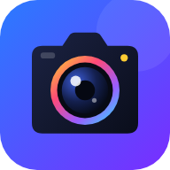

# 📷 Camera App — *Colorful Pose & Speech Recorder*

**A colorful camera that lives in your browser.** Snap photos with 12 live filters, use a self-timer and burst mode, record video, zoom, keep everything in an offline gallery, and run AI sessions that track your body and transcribe what you say. 🤖🎙️

[](https://jaineil32624.github.io/camera_app/)
[](https://github.com/jaineil32624/camera_app/releases/latest/download/CameraApp.apk)
[](https://github.com/jaineil32624/camera_app/releases/latest)


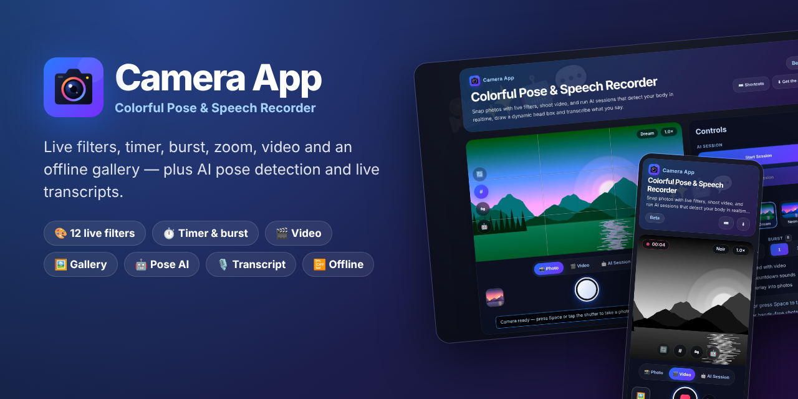

</div>

---

## ✨ Features

| | Feature | What it does |
|---|---|---|
| 📸 | **Three modes** | **Photo**, **Video** and **AI Session**, one big shutter for all of them |
| 🎨 | **12 live filters** | Vivid, Mono, Noir, Sepia, Warm, Cool, Dream, Neon, Retro, Fade, Invert. Chips show a *live* preview of your camera, and the filter is baked into photos and videos |
| ⏱️ | **Self-timer** | Off · 3 s · 10 s with a big animated countdown and beeps. Press `Esc` or the shutter to cancel |
| 💥 | **Burst mode** | Fire 3 or 5 shots in a row |
| 🎬 | **Video recording** | Records the *filtered* preview with `MediaRecorder`, with optional sound, pause/resume and a live REC timer |
| 🔍 | **Zoom** | Real hardware zoom when the camera supports it, smooth digital zoom otherwise. Pinch, slider, `Ctrl`+scroll or `+`/`-` |
| 🔄 | **Front / back switch** | One tap (or double-tap the preview) |
| #️⃣ | **Grid & mirror** | Rule-of-thirds overlay; mirror the selfie view |
| 🔦 | **Torch** | Appears automatically on phones whose camera has a flashlight |
| ⚡ | **Flash & feel** | White flash, shutter sound, haptics, and the shot flies into the gallery button |
| 🖼️ | **Offline gallery** | Every capture is stored on your device in IndexedDB. Filter by photos/videos, view full size, **download, share or delete**, browse with ← → |
| 🤖 | **AI pose overlay** | MoveNet (TensorFlow.js) draws a rainbow skeleton, keypoints and a dynamic **HEAD** box. You can burn it into your photos |
| 🎙️ | **AI Session** | The original feature: records camera + mic together, transcribes speech live, lists body keypoints, guesses expression 😄🤔😢, says out loud when you shake your hand 👋, and saves the transcript as a .txt |
| 🚫 | **Friendly error states** | Clear screens for *permission blocked*, *no camera*, *camera busy*, *insecure page* and *unsupported browser*, each with a retry button |
| ⌨️ | **Keyboard shortcuts** | `Space` shutter · `1` `2` `3` modes · `[` `]` filters · `T` timer · `B` burst · `G` grid · `F` flip · `M` mirror · `A` pose · `L` last shot · `P` pause · `?` help |
| 🔗 | **Share your setup** | Copies a link such as `?filter=noir&timer=3&burst=3&grid=1` that opens the camera with the same settings |
| 💾 | **Remembers you** | Mode, filter, timer, burst, grid and toggles are saved between visits |

## 📸 Screenshots

<table>
<tr>
<td>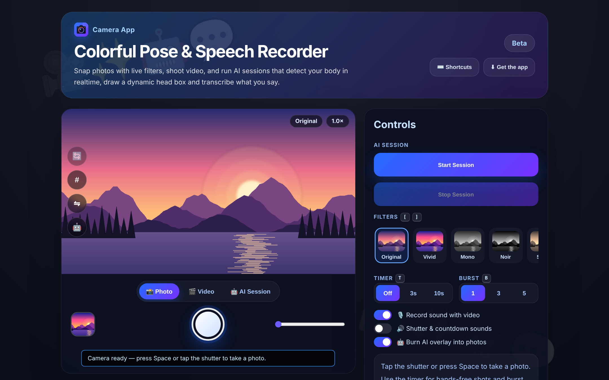<p align="center">📷 <b>Photo mode</b>: live preview, modes, shutter</p></td>
<td>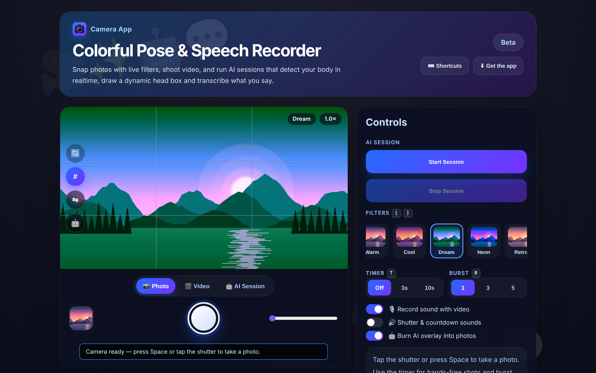<p align="center">🎨 <b>Live filters</b> + rule-of-thirds grid</p></td>
</tr>
<tr>
<td>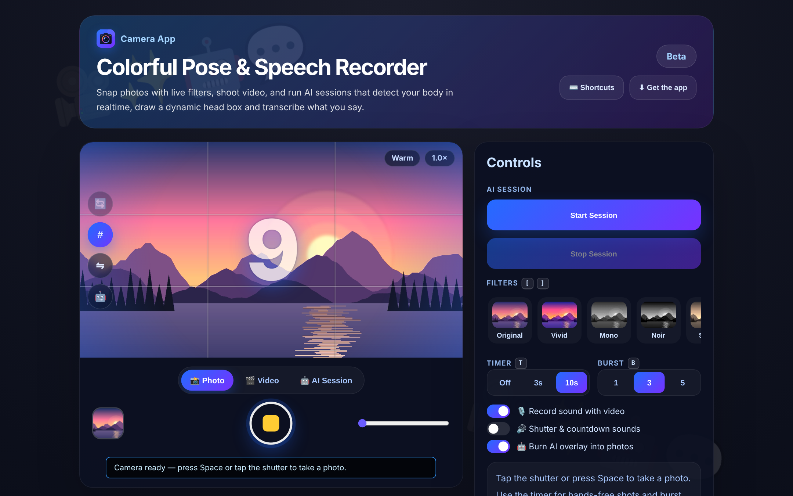<p align="center">⏱️ <b>10-second timer</b> with 3-shot burst</p></td>
<td>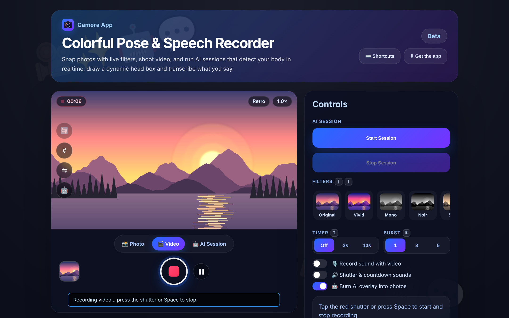<p align="center">🎬 <b>Recording video</b> with the Retro filter</p></td>
</tr>
<tr>
<td>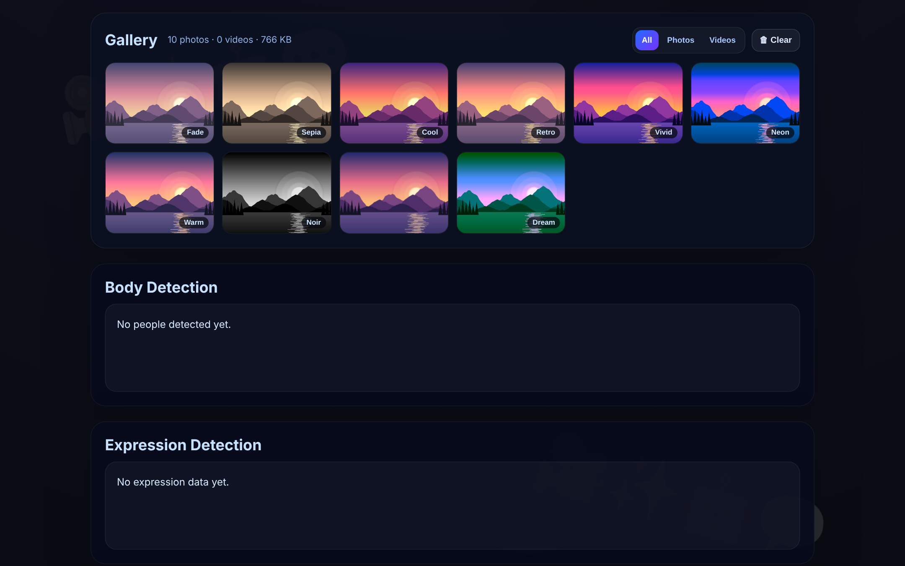<p align="center">🖼️ <b>Offline gallery</b> stored in IndexedDB</p></td>
<td>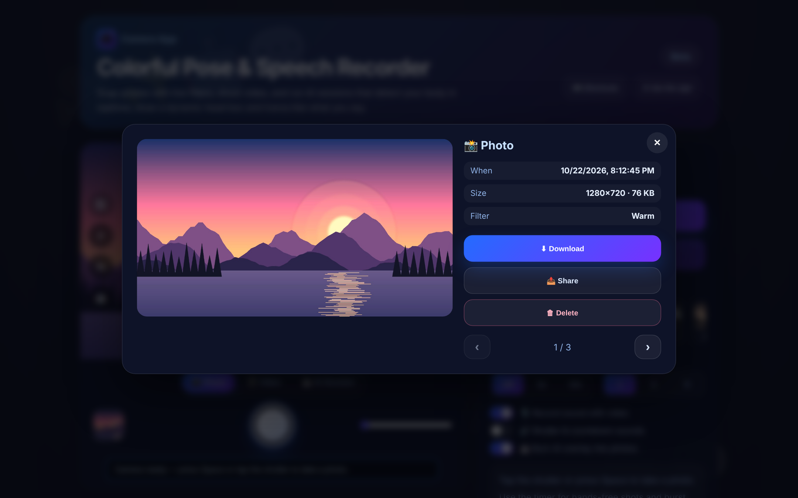<p align="center">🔎 <b>Viewer</b>: download, share, delete</p></td>
</tr>
<tr>
<td>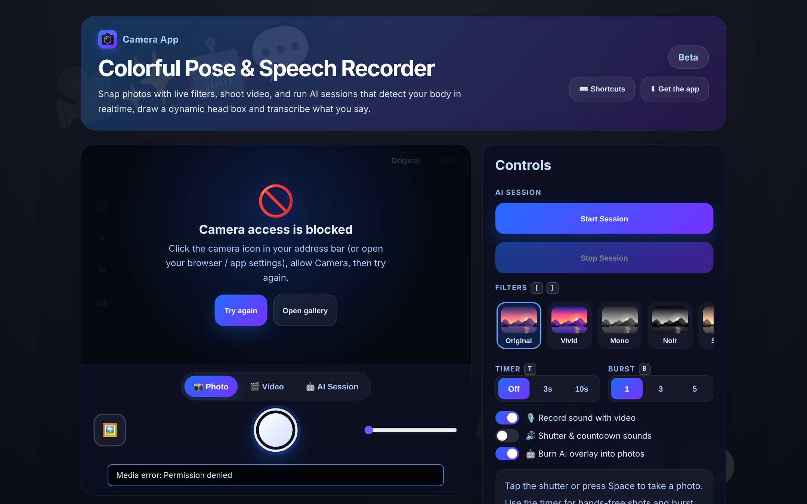<p align="center">🚫 <b>Helpful states</b> when the camera is blocked</p></td>
<td>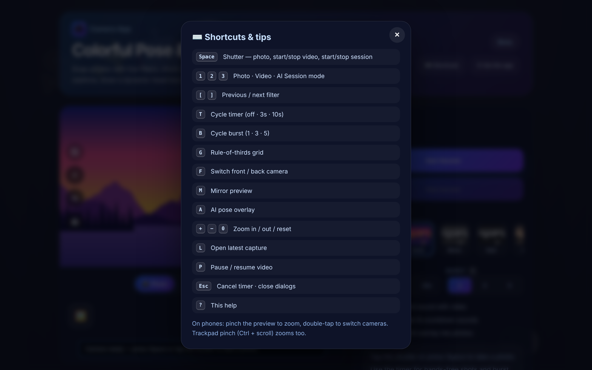<p align="center">⌨️ <b>Shortcuts</b> overlay (<code>?</code>)</p></td>
</tr>
</table>

<p align="center">
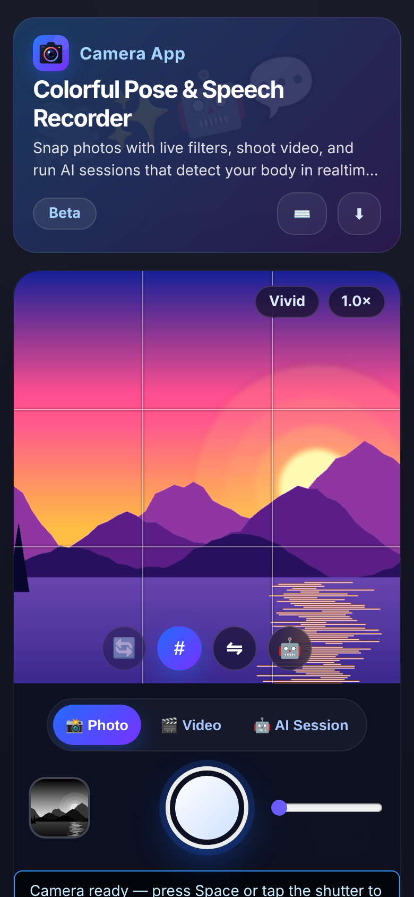
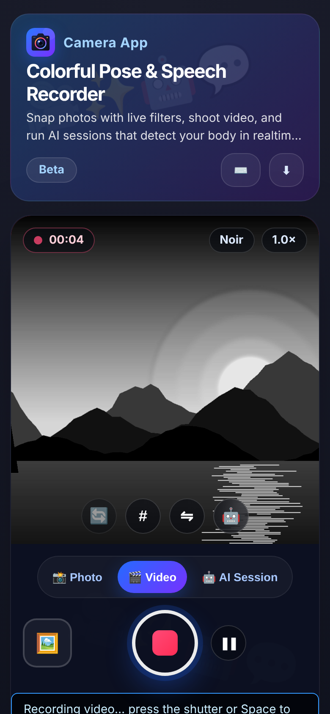
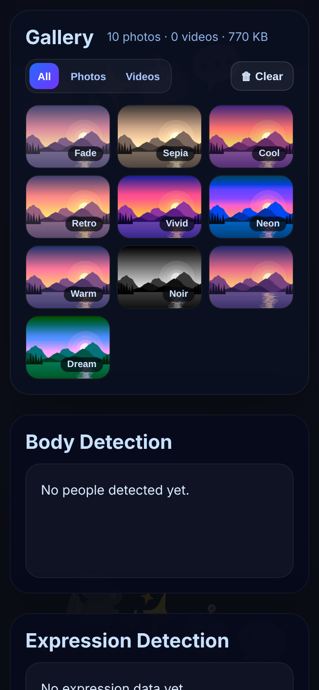
<br><em>📱 Made for phones: pinch to zoom, double-tap to flip, big thumb-friendly shutter</em>
</p>

## 📥 Get Camera App

| Platform | How |
|---|---|
| 🌐 **Web** | Open **[jaineil32624.github.io/camera_app](https://jaineil32624.github.io/camera_app/)**, nothing to install |
| 🤖 **Android** | Download **[CameraApp.apk](https://github.com/jaineil32624/camera_app/releases/latest/download/CameraApp.apk)** → open it → allow *Install unknown apps* if asked → allow **Camera** and **Microphone** |
| 💻 **Windows / Mac / Chromebook** | Open the website in Chrome or Edge → **⬇ Get the app** → **Install** |
| 🍎 **iPhone / iPad** | Open the website in Safari → **Share** → **Add to Home Screen** |
| 📦 **Offline zip** | Grab **CameraApp-web.zip** from [Releases](https://github.com/jaineil32624/camera_app/releases/latest), unzip, and serve the folder locally (browsers only allow cameras on `https://` or `localhost`) |

> 💡 Your photos and videos **never leave your device**. No account, no ads, no tracking. Once installed, the app works offline, including the bundled AI pose model.

<p align="center">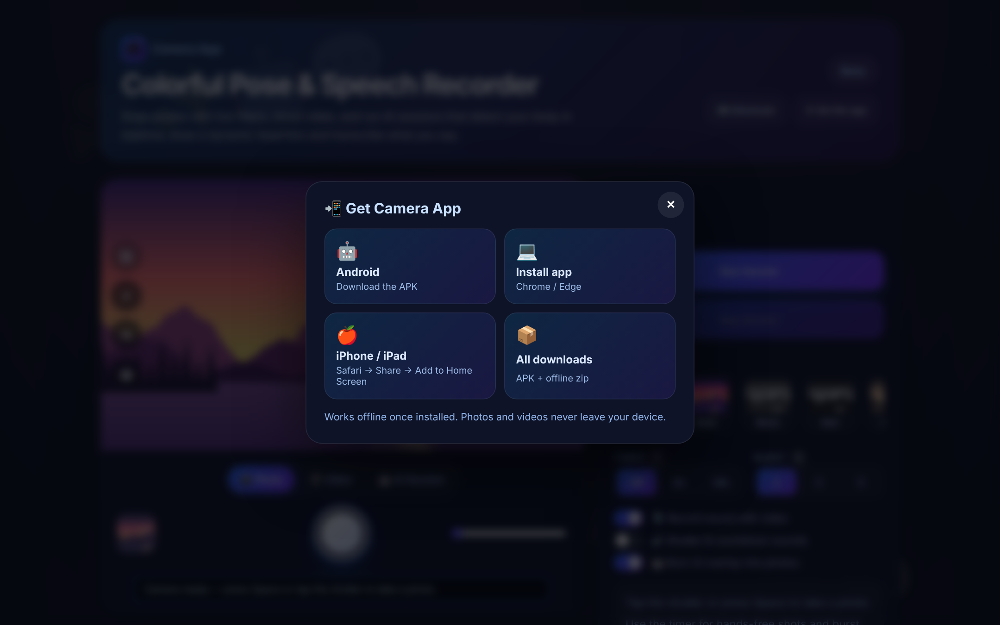</p>

## 🛠️ Run it locally

```bash
git clone https://github.com/jaineil32624/camera_app.git
cd camera_app
python3 -m http.server 8000      # then open http://localhost:8000
```

There's no build step. Use `localhost` (not `file://`) so the browser lets the page use the camera.

## 🗂️ Project structure

```
camera_app/
├── index.html              🧱 layout + meta tags
├── style.css               🎨 the colorful dark glass theme
├── script.js               🧠 camera, filters, timer, burst, video, gallery, pose + speech
├── sw.js                   📴 offline service worker
├── manifest.webmanifest    📲 installable-app manifest
├── icons/                  🖼️ app icons (SVG + PNG + maskable)
├── vendor/                 🤖 TensorFlow.js, pose-detection and the MoveNet model, bundled for offline use
├── docs/screenshots/       📸 images for this README
├── VERSION                 🏷️ bump to publish a new release
└── .github/workflows/
    ├── release.yml         🤖 builds the Android APK + publishes a Release
    └── vendor.yml          ⬇️ refreshes the offline AI libraries
```

## 🚀 Releasing a new version

Bump the number in `VERSION` and push. GitHub Actions builds the APK (with camera and microphone permissions) and publishes the release automatically:

```bash
echo "1.1.0" > VERSION
git commit -am "Release 1.1.0" && git push
```

---

<div align="center">

Made with 💜, 📸 and a lot of 🤖 by **[Jaineil Rana](https://github.com/jaineil32624)**

⭐ *If Camera App made you smile for the camera, give it a star!* ⭐

</div>
